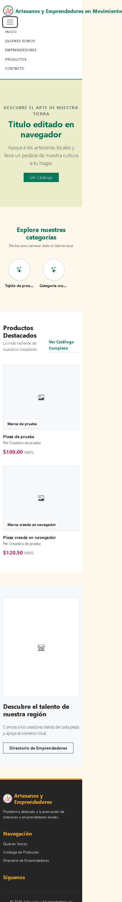
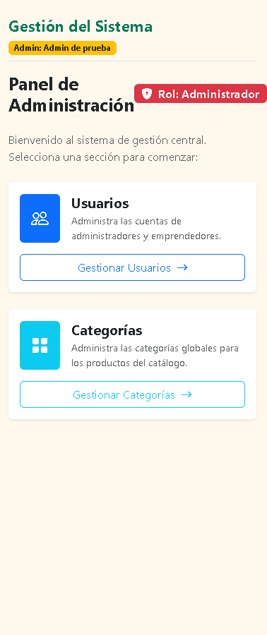

# Auditoría de seguridad, funcionamiento y experiencia de uso

Proyecto: ArtesanosEnMovimiento. Pruebas realizadas el 3 de noviembre de 2026; informe preparado para revisión el 4 de noviembre. Referencia de código: `7dbb0be0d836c62b981a345a9d5e077bd8ce4b19`, con los cambios locales de autenticación que ya estaban en la rama `auditoria/seguridad-flujo-2026-11-03`.

## Qué se revisó y qué entrega este trabajo

La revisión buscó comprobar que los recorridos habituales funcionan y después intentar romper sus supuestos: enviar campos que la pantalla no ofrece, usar datos de otra cuenta, consultar publicaciones inactivas, provocar errores de validación y comprobar qué queda guardado cuando una operación falla. También se recorrieron las pantallas con navegador, teclado y tamaños móviles.

Esta entrega reúne el diagnóstico, las reproducciones y sus evidencias. Las correcciones propuestas siguen pendientes. Los cambios de autenticación que ya existían en la copia local pertenecen al trabajo anterior y no se presentan como correcciones hechas durante esta auditoría.

El alcance fue el código propio disponible y su ejecución local. Se revisaron rutas, middleware, controladores, modelos, relaciones, migraciones, formularios y vistas públicas. El mapa técnico incluyó 52 registros de funciones. Se usaron las instrucciones `audit-context-building` y `variant-analysis` de la colección [Trail of Bits](https://github.com/trailofbits/skills), Semgrep para el análisis estático y Hallmark para la revisión de interfaz. La redacción se revisó con la skill humanizador.

No se probó el servidor de producción, sus reglas de hosts, TLS, proxy, cookies efectivas, permisos del sistema operativo, entrega real de correo ni restauración de respaldos. Tampoco se ejecutaron campañas de carga o concurrencia. Por eso, el cierre corresponde a esta auditoría local y no certifica que el sistema esté libre de otros errores.

## Resultados de las comprobaciones

| Comprobación | Resultado y alcance |
| --- | --- |
| Suite existente de la aplicación | El usuario ejecutó 74 pruebas: todas pasaron, con 530 aserciones. Es el resultado previo a esta entrega documental. |
| Suite de auditoría | 35 pruebas, 184 aserciones: 15 aprobadas y 20 fallidas. Los fallos reproducen defectos, variantes o expectativas de endurecimiento; no equivalen a 20 vulnerabilidades independientes. |
| Compilación | `npm run build` terminó correctamente. Hubo una advertencia opcional de fontaine. |
| Recorridos de navegador | 59 comprobaciones en dos tandas: 58 cumplidas y una fallida por falta de mensaje al bloquear la autodesactivación. Incluyen respuestas y acciones dentro de los recorridos. |
| Diseño móvil | 12 combinaciones: visitante, administrador y emprendedor a 320, 375, 414 y 768 px. |
| Accesibilidad automatizada | Cinco páginas con axe-core: ocho registros de tipo/página con problemas. No es una certificación WCAG. |
| Dependencias npm | Cero avisos conocidos reportados en la ejecución; 142 dependencias según el resultado. |
| Dependencias Composer | Dos avisos en Symfony. Se distingue la versión afectada de una explotación demostrada en la aplicación. |
| Semgrep | 13 paquetes previstos, 11 con resultados, dos no disponibles; dos de los 11 tuvieron errores parciales. Se revisaron 20 alertas informativas y se descartaron como falsos positivos de código malicioso. |

Versiones comprobadas durante la auditoría: PHP 8.5.0, Laravel 13.31.0, PHPUnit 12.5.35, Symfony HttpFoundation y Mime 7.4.18, Semgrep OSS 1.183.0. Los avisos de dependencias corresponden a esa fecha y esas versiones.

## Cómo leer y repetir los casos

Las rutas de este informe son relativas al sitio local. Por ejemplo, `/emprendedor/perfil` se abre agregando esa ruta a la dirección donde se ejecuta la aplicación.

Para las peticiones modificadas, se necesita una sesión válida del rol indicado y conservar el token CSRF. En las herramientas de desarrollo del navegador, la pestaña Red permite identificar la solicitud que envía el formulario. Un cliente HTTP con esa sesión, o una herramienta de interceptación local, permite reenviarla cambiando el cuerpo. Los formularios Laravel pueden enviar un POST con `_method=PUT`; las rutas de este informe indican el método efectivo. El hecho de que un campo no aparezca en pantalla no impide enviarlo en una solicitud.

Las cuentas A y B, los IDs y los productos de ejemplo son datos de prueba. `user_id` identifica una fila de `users`; `emprendedor_id` identifica una fila de `emprendedores`. No son identificadores intercambiables. Use registros propios de una base desechable para comprobar los cambios de propietario, las bajas y las migraciones.

Se incluye una [suite de reproducción](evidencias/auditoria-2026-11-03/AuditSecurityTest.php) y un [ejecutor PowerShell](evidencias/auditoria-2026-11-03/Ejecutar_Auditoria.ps1). Desde la raíz del repositorio, con PHP y las dependencias instaladas:

```powershell
& '.\docs\evidencias\auditoria-2026-11-03\Ejecutar_Auditoria.ps1'
```

Para ejecutar un grupo concreto:

```powershell
& '.\docs\evidencias\auditoria-2026-11-03\Ejecutar_Auditoria.ps1' -Filter 'profile_owner|product_owner|brand_owner'
```

El ejecutor establece el entorno de pruebas y restaura las variables del proceso al terminar. La clase fuerza SQLite en memoria, correo en memoria y almacenamiento público simulado. La suite se conserva fuera de `tests/` para poder revisarla y ejecutarla de forma explícita: sus expectativas fallan mientras los defectos sigan presentes. Un código de salida distinto de cero es el resultado esperado en el estado auditado. Los tokens y correos de recuperación se comprueban dentro del proceso, sin enviarse a destinatarios reales.

Las prioridades del informe sirven para ordenar el trabajo; no son puntuaciones CVSS. Cada caso indica si el resultado está reproducido, si depende de una condición o si se trata de una propuesta.

## Vulnerabilidades y debilidades de seguridad

### S01. El formulario permite cambiar el propietario de un registro

Prioridad alta. Reproducido en perfil, marca y producto. Requiere una cuenta de emprendedor activa y un objeto propio sobre el que hacer el cambio.

Cómo se encontró: se siguió el recorrido de los datos desde la solicitud hasta `update()`. En [EmprendedorController](../app/Http/Controllers/EmprendedorController.php), `perfilUpdate`, `marcasUpdate` y `productosUpdate` validan parte de la entrada, pero guardan datos obtenidos mediante `all()` o `except()`. Los modelos permiten asignar los identificadores de propietario mediante `$fillable`. Se escribieron tres pruebas para comprobar si un campo adicional llegaba a la base de datos.

Dónde y cómo reproducirlo:

1. Crear dos cuentas de prueba, A y B, con sus perfiles. Entrar al portal como A.
2. Abrir la pantalla correspondiente y guardar una edición normal para identificar su solicitud.
3. Reenviar la solicitud agregando el campo de la tabla. Para marcas y productos, conservar los demás campos obligatorios válidos.
4. Comprobar el propietario directamente en la base de prueba; la respuesta de éxito por sí sola no demuestra el cambio.

| Pantalla | Solicitud | Campo agregado | Resultado observado |
| --- | --- | --- | --- |
| Mi perfil: `/emprendedor/perfil` | `PUT /emprendedor/perfil` | `user_id=<id de otro usuario existente>` | El perfil de A quedó asociado al usuario indicado. |
| Editar una marca propia: `/emprendedor/marcas/{id}/editar` | `PUT /emprendedor/marcas/{id}` | `emprendedor_id=<id del perfil B>` | La marca propia pasó al perfil B. |
| Editar un producto propio: `/emprendedor/productos/{id}/editar` | `PUT /emprendedor/productos/{id}` | `emprendedor_id=<id del perfil B>` | El producto propio pasó al perfil B. |

Qué implica: permite alterar la atribución de publicaciones y la relación entre una cuenta y su perfil. Puede dejar datos asociados a una cuenta que no hizo esa publicación y sacar objetos del inventario de su propietario original. La búsqueda inicial del objeto sí comprueba al dueño; el fallo ocurre al guardar los campos adicionales. Estas pruebas no demostraron edición directa de cualquier objeto ajeno ni conversión de una cuenta en administrador.

Propuesta: guardar únicamente los campos que devuelve una validación explícita. Derivar el propietario de la sesión y mantenerlo fuera de las operaciones de edición ordinaria. Revisar si la relación usuario/perfil debe ser única y sanear los datos existentes antes de agregar una restricción.

Criterio de cierre: las tres solicitudes deben rechazar o ignorar el propietario recibido y conservar el vínculo original. Pruebas: `test_profile_owner_is_not_writable_through_profile_form`, `test_brand_owner_is_not_writable_through_brand_form` y `test_product_owner_is_not_writable_through_product_form`. Clasificación orientativa: CWE-915.

### S02. Un producto puede usar la marca de otro emprendedor

Prioridad media. La asociación se reprodujo al crear un producto. La misma validación insuficiente existe en edición.

Cómo se encontró: al comparar el selector de marcas con las reglas de `productosStore` y `productosUpdate`, apareció una diferencia: la pantalla ofrece marcas propias, pero el servidor solo valida `exists:marcas,id`. La prueba envió una marca válida perteneciente a B desde la sesión de A.

Reproducción:

1. Crear una marca para B en la base de prueba y anotar su ID.
2. Como A, abrir `/emprendedor/productos/crear` y completar nombre, descripción, precio y categoría con valores válidos.
3. Reenviar `POST /emprendedor/productos` cambiando `marca_id` por el ID de la marca de B.
4. Consultar el producto guardado: su propietario sigue siendo A, pero su `marca_id` apunta a la marca ajena.

En edición, la ruta a revisar es `PUT /emprendedor/productos/{id}`. El ID del producto debe ser de A.

Qué implica: una publicación puede atribuirse a una marca que no le pertenece. Se afecta la confianza del catálogo y sus filtros. No se modificó la fila de la marca de B.

Propuesta: comprobar existencia y pertenencia de `marca_id` al mismo perfil autenticado, tanto al crear como al editar. Cierre: una marca ajena debe producir un error de validación y no alterar datos. Prueba: `test_product_cannot_use_another_entrepreneurs_brand`. Clasificación orientativa: CWE-639.

### S03. El CMS guarda archivos que no son imágenes

Prioridad media. Requiere una sesión de administrador. Se confirmó la persistencia de un archivo de texto, sin probar ejecución de código.

Cómo se encontró: `configuracionesUpdate` en [AdminController](../app/Http/Controllers/AdminController.php) usa `hasFile()` y `store('cms', 'public')` para los banners, sin una validación previa de imagen, tipo o tamaño específico. El atributo `accept` del formulario no valida el contenido en el servidor.

Reproducción:

1. Entrar como administrador y abrir `/admin/configuraciones`.
2. Preparar un archivo `audit.txt` con texto inocuo.
3. Enviar una petición multipart a `PUT /admin/configuraciones` con ese archivo en `home_banner_image`. El otro campo que usa el mismo patrón es `home_promo_image`.
4. Revisar el almacenamiento público y el valor de configuración: la prueba dejó un archivo `cms/*.txt`.

Qué implica: el servidor admite un contenido diferente del prometido por la pantalla y lo coloca en almacenamiento público. La posibilidad de ejecutar PHP, interpretar HTML o provocar XSS depende de la configuración y del modo de servir el archivo; esos impactos no se demostraron. Los límites generales de PHP o del proxy siguen aplicando.

Propuesta: aceptar solo imágenes reales de los formatos necesarios, con límites de tamaño y dimensiones. Enumerar los campos de configuración permitidos y mantener el almacenamiento de subidas sin ejecución de scripts. Cierre: el texto debe rechazarse antes de escribir en disco o cambiar la configuración. Prueba: `test_cms_rejects_a_non_image_upload`. Clasificación orientativa: CWE-434.

### S04. Un producto inactivo sigue visible en otras páginas públicas

Prioridad media de publicación. La inconsistencia está reproducida; su gravedad como exposición depende de la definición de «inactivo».

Cómo se encontró: [PublicController](../app/Http/Controllers/PublicController.php) filtra `estado=activo` en portada y catálogo. `productoDetalle` busca por ID sin ese filtro y `emprendedorPerfil` carga todos los productos del perfil. Las pruebas comprobaron ambas salidas públicas.

Reproducción:

1. Crear un producto activo de prueba y guardar su ID y el de su perfil.
2. Establecer `estado=inactivo` en esa fila de la base desechable. Esto prepara el caso aunque la interfaz no ofrezca un control para ese estado.
3. Abrir `/productos`: el producto queda fuera de la consulta del catálogo.
4. Abrir `/producto/{id}`: responde 200 y muestra el detalle.
5. Abrir `/emprendedor/{idDelPerfil}`: su listado también muestra la pieza inactiva.

Qué implica: dejar de aparecer en el catálogo no equivale a dejar de ser accesible. Si inactivo significa borrador o retirado, hay publicación indebida. Si significa «accesible por enlace», se debe explicar y aplicar esa política también al perfil.

Propuesta: definir los estados de producto y compartir la regla de publicación entre todas las consultas públicas. Cierre: pruebas coherentes con la política acordada para catálogo, detalle, perfil y relacionados. Pruebas actuales: `test_inactive_product_is_not_public_by_direct_id` y `test_inactive_product_is_not_listed_on_the_public_creator_profile`.

La regla ya acordada para cuentas es distinta: desactivar a un emprendedor debe impedir su acceso al portal y conservar públicos su perfil y sus productos. Ese comportamiento se comprobó y se considera correcto.

### S05. La recuperación puede generar enlaces con un dominio recibido en la petición

Prioridad alta condicionada al despliegue. Se reprodujo la generación del enlace; no se probó una toma de cuenta.

Cómo se encontró: se siguió `sendResetLinkEmail` en [ForgotPasswordController](../app/Http/Controllers/Auth/ForgotPasswordController.php) hasta el broker y la notificación de Laravel. La URL se construye con el contexto de la petición y [bootstrap/app.php](../bootstrap/app.php) no declara `trustHosts`. Se comprobó el correo resultante con el transporte en memoria.

Reproducción aislada:

1. Crear una cuenta sintética y configurar el transporte de correo `array`.
2. Enviar al kernel local una petición `POST http://untrusted.example.test/forgot-password` con el correo de esa cuenta. La URL del test establece un host distinto del origen esperado.
3. Inspeccionar el mensaje almacenado en memoria.
4. El correo generado contiene un enlace cuyo origen es `http://untrusted.example.test/reset-password/`.

La prueba no hizo una conexión de red a ese dominio ni envió un correo real. Se puede repetir con `-Filter 'password_reset_email_does_not_use_an_untrusted_request_host'`.

Qué implica: si el servidor de despliegue acepta un `Host` arbitrario y el destinatario abre el enlace, el dominio ajeno podría recibir el token. Falta verificar esa aceptación en el despliegue real; tampoco se simuló el clic de una víctima. La evidencia local demuestra que la aplicación incorpora el host no confiable al mensaje.

Propuesta: restringir los hosts aceptados en servidor y aplicación, y construir los enlaces sobre un origen canónico confiable. Cierre: la petición debe rechazarse o producir un correo con el dominio permitido. Véase [la documentación de Laravel sobre hosts confiables y recuperación](https://laravel.com/framework/docs/13.x/passwords#configuring-trusted-hosts). Prueba: `test_password_reset_email_does_not_use_an_untrusted_request_host`.

### V01. Los enlaces sociales aceptan protocolos que no corresponden a una red social

Prioridad baja de endurecimiento. Persistencia confirmada; ejecución de JavaScript no demostrada.

Cómo se encontró: las reglas del perfil validan Facebook, Instagram y TikTok como cadenas. La vista pública coloca esos valores en enlaces. Escapar HTML no es lo mismo que comprobar el protocolo de una URL.

Reproducción: entrar como emprendedor, abrir `/emprendedor/perfil` y enviar `facebook=javascript:void(0)` a `PUT /emprendedor/perfil`. Consultar el perfil guardado: conserva ese valor. La prueba no depende de hacer clic ni de ejecutar código en el navegador.

Qué implica: se aceptan enlaces fuera del propósito del formulario. No se presenta como XSS explotado, porque ese comportamiento no se verificó y depende del enlace y del navegador.

Propuesta: validar URL y permitir HTTP(S); decidir si cada campo debe pertenecer a los dominios de la red indicada. Cierre: rechazar protocolos no permitidos y conservar enlaces válidos. Prueba: `test_profile_rejects_an_untrusted_social_link_scheme`.

## Errores de flujo, datos y operación

### F01. Crear un producto sin descripción provoca un error 500

Prioridad alta de funcionamiento. Reproducido mediante solicitud al servidor.

Cómo se encontró: la validación de producto acepta `descripcion` como `nullable`, mientras la migración de `productos` exige un valor no nulo. Se probó el caso que la regla del servidor declara válido.

Desde dónde: formulario `/emprendedor/productos/crear`, solicitud `POST /emprendedor/productos`.

Reproducción: entrar como emprendedor y enviar nombre, precio y categoría válidos, omitiendo `descripcion`. Si el navegador obliga a completarla, repetir la solicitud HTTP sin ese campo. La respuesta observada fue 500 con `NOT NULL constraint failed: productos.descripcion` en SQLite.

Qué implica: una entrada admitida por la validación termina como fallo interno. La persona pierde el recorrido de alta y puede reintentar sin saber qué ocurrió. La regla incompatible también debe revisarse en edición.

Propuesta: decidir si la descripción es obligatoria y hacer coincidir esquema, formulario y validación. Cierre: creación correcta cuando sea opcional o error de validación cuando sea requerida; nunca 500 por esa ausencia. Prueba: `test_optional_product_description_does_not_cause_server_error`.

### F02. El perfil ofrece cambiar el nombre, pero no lo guarda

Prioridad media. Reproducido.

Cómo se encontró: se comparó `resources/views/emprendedores/perfil.blade.php` con `perfilUpdate`. El nombre pertenece a `User`, pero el método actualiza únicamente el perfil `Emprendedor`.

Reproducción: entrar al portal, abrir `/emprendedor/perfil`, escribir otro nombre y guardar. Volver a cargar la pantalla y consultar `users.name`: conserva el nombre anterior, aunque la respuesta informa que el perfil se actualizó.

Qué implica: la pantalla promete una edición que no realiza. También confunde el nombre de la cuenta con la identidad pública del creador.

Propuesta: guardar el nombre validado en su modelo o ajustar el formulario si ese dato debe administrarse en otro lugar. Cierre: después de guardar y recargar, el dato ofrecido como editable debe coincidir con lo introducido. Prueba: `test_profile_form_saves_the_name_it_offers_to_edit`.

### F03. Rechazar una foto adicional no revierte los demás cambios del producto

Prioridad media. Reproducido.

Cómo se encontró: en `productosUpdate`, la llamada a `update()` ocurre antes de comprobar la suma de fotos existentes y nuevas. Se preparó un producto en el límite de diez imágenes.

Reproducción:

1. Crear un producto de prueba con diez filas de imágenes.
2. Abrir `/emprendedor/productos/{id}/editar` como su dueño.
3. Cambiar el nombre y adjuntar una imagen válida adicional.
4. Enviar `PUT /emprendedor/productos/{id}`.
5. La respuesta contiene un error para `imagenes`, pero al consultar la fila el nombre ya cambió.

Qué implica: el mensaje de error sugiere un rechazo de la edición, aunque una parte sí quedó guardada. Los reintentos y la falta de claridad pueden causar cambios accidentales.

Propuesta: hacer toda la validación antes de escribir y coordinar las filas con una transacción. Los archivos necesitan su propia compensación. Cierre: el rechazo por exceso de fotos conserva todos los datos anteriores. Prueba: `test_failed_image_limit_does_not_partially_update_product`.

### F04. El único administrador activo puede quitarse el rol de administrador

Prioridad alta de operación. Reproducido con una sola cuenta administrativa en la base de prueba.

Cómo se encontró: `usuariosUpdate` protege la desactivación del último administrador cuando `status=inactivo`, pero no contempla que cambie su rol manteniendo `status=activo`.

Reproducción: en una base desechable con un solo administrador activo, entrar como esa cuenta, abrir `/admin/usuarios/{id}/editar`, cambiar su rol a `emprendedor` y conservar estado activo. Guardar con `PUT /admin/usuarios/{id}`. La fila queda con el nuevo rol y el conteo de administradores activos es cero.

Qué implica: se pierde el acceso administrativo ordinario y hace falta una intervención de mantenimiento para recuperar una cuenta. Es un error de integridad administrativa; no demuestra que un emprendedor haya escalado privilegios.

Propuesta: proteger la existencia de al menos un administrador activo ante cambios de rol, estado y eliminación. La implementación debe considerar dos operaciones concurrentes. Cierre: impedir el cambio si deja el sistema sin administración y explicar el motivo. Prueba: `test_last_active_admin_cannot_remove_own_admin_role`.

### F05. Dos categorías con nombres distintos pueden producir el mismo slug y un error 500

Prioridad media. Reproducido.

Cómo se encontró: `categoriasStore` valida unicidad del nombre y después calcula `Str::slug`. La base exige que el slug también sea único. Dos nombres distintos pueden normalizarse al mismo valor.

Reproducción: como administrador, crear `Tejido Fino` desde `/admin/categorias/crear`. Después crear `Tejido-Fino`. Los nombres son distintos, pero ambos producen `tejido-fino`. El segundo `POST /admin/categorias` llega a la restricción UNIQUE de la base y falla, en vez de devolver una explicación en el formulario.

Qué implica: una operación habitual depende de conocer una regla que la interfaz no explica. La misma derivación debe revisarse al editar.

Propuesta: validar el valor derivado o generar un slug único de forma controlada, y tratar la colisión como validación. Cierre: la segunda operación recibe una respuesta comprensible, conserva la entrada y no provoca un error SQL. Prueba: `test_categories_with_colliding_slugs_return_validation_errors`.

### F06. Dos migraciones intentan revertir nombres de tabla diferentes de los que crearon

Prioridad alta para recuperación y mantenimiento. Dos variantes reproducidas en SQLite en memoria.

Cómo se encontró: lectura comparada de los métodos `up()` y `down()`, seguida de una comprobación de existencia de tablas.

| Migración | Tabla creada | Tabla que intenta borrar `down()` |
| --- | --- | --- |
| `2026_09_28_210714_create_emprendedors_table.php` | `emprendedores` | `emprendedors` |
| `2026_10_19_213459_create_configuracions_table.php` | `configuraciones` | `configuracions` |

Reproducción: ejecutar las pruebas `test_entrepreneur_migration_down_removes_the_table_it_created` y `test_configuration_migration_down_removes_the_table_it_created`. Cada una carga su migración, llama a `down()` en la base de prueba y comprueba que la tabla original desapareció. Ambas tablas permanecieron.

Qué implica: una reversión puede dejar el esquema en un estado que no corresponde al historial esperado y dificultar una migración posterior. No se ejecutó un rollback sobre la base del proyecto.

Propuesta: corregir los nombres y comprobar migración, reversión y nueva migración en una base desechable. Cierre: cada `down()` elimina la tabla que creó su `up()`.

### F07. El servidor acepta precios negativos

Prioridad media de negocio. Reproducido.

Cómo se encontró: `precio` se valida como `required|numeric`, sin mínimo ni rango de negocio. Se envió un valor numérico fuera de lo razonable para una pieza del catálogo.

Reproducción: como emprendedor, enviar un alta válida a `POST /emprendedor/productos` con `precio=-1.00`. Si la pantalla impone un mínimo, modificar la solicitud antes de reenviarla. La fila se guardó con precio negativo.

Qué implica: el catálogo puede publicar importes incorrectos. No existe checkout en el alcance revisado, por lo que no se afirma un cobro negativo ni una pérdida transaccional demostrada.

Propuesta: definir mínimo, máximo y precisión, incluida la decisión sobre precio cero. Aplicarlos en creación y edición. Cierre: los valores fuera del rango deben dar un error de validación y no persistirse. Prueba: `test_negative_price_is_rejected`.

### F08. Un filtro de búsqueda con forma de arreglo provoca un error 500

Prioridad baja. No requiere autenticación. Reproducido.

Cómo se encontró: el catálogo concatena el valor de búsqueda con `%` sin validar que sea una cadena. Se cambió la forma de ese parámetro.

Reproducción: abrir `/productos?buscar%5B%5D=pieza`, equivalente a `/productos?buscar[]=pieza`. El servidor interpreta `buscar` como arreglo y devuelve 500 por conversión de arreglo a cadena.

Qué implica: una petición pública mal formada produce un fallo interno. No se demostró SQL injection ni lectura de información mediante ese parámetro.

Propuesta: validar tipo y longitud de los filtros antes de construir la consulta; rechazar o normalizar la entrada de forma definida. Cierre: esta URL no debe producir un error 500. Prueba: `test_catalog_handles_an_array_search_without_a_server_error`.

### F09. Eliminar un usuario deja archivos de productos en el disco público

Prioridad baja, sujeta a la política de retención. Reproducido con almacenamiento simulado.

Cómo se encontró: se comparó el borrado directo de producto, que limpia su galería, con la eliminación de usuario, que depende de cascadas SQL. Borrar filas por cascada no ejecuta automáticamente una limpieza de archivos.

Reproducción: crear un emprendedor con un producto y una foto; anotar su ruta. Como otro usuario administrador, eliminar esa cuenta desde `/admin/usuarios`, mediante `DELETE /admin/usuarios/{id}`. Las filas de usuario y galería desaparecen, pero el archivo sigue presente en el disco público simulado.

Qué implica: quedan archivos sin un registro que los gestione. Esto consume espacio y dificulta cumplir una eliminación definitiva si esa es la política. No se demostró exposición de un archivo privado real.

Propuesta: decidir qué se conserva al eliminar, durante cuánto tiempo y cómo se limpia o reintenta una operación fallida. Mantener esa política separada de desactivar una cuenta, que conserva la publicación por acuerdo de negocio. Cierre: el comportamiento de archivos debe coincidir con la política y tener una comprobación automatizada. Prueba: `test_deleting_a_user_does_not_leave_public_product_files`.

### F10. Una avería al guardar una foto deja un producto creado a medias

Prioridad media de consistencia. Reproducido mediante una excepción inyectada, no por un fallo remoto provocado por un visitante.

Cómo se encontró: `productosStore` crea el producto y guarda archivos antes de completar las filas de galería. Se simuló una avería en ese último paso para revisar el estado final.

Reproducción: ejecutar `test_a_failed_photo_row_insert_does_not_leave_a_partial_product`. La prueba registra un listener temporal en `eloquent.creating` de `ProductoImagen` que lanza una excepción, envía un alta válida con imagen y revisa la base. La respuesta es 500, pero queda una fila de producto. El listener se retira al terminar. El código ya permite observar que las escrituras previas no se coordinan; la aserción que falla demuestra el producto residual, no un inventario completo de todos los archivos que pudieran quedar.

Qué implica: después de un error, la persona puede encontrar una publicación incompleta o duplicarla al reintentar.

Propuesta: transacción para los registros y compensación de archivos si falla cualquier paso. Cierre: ante la avería simulada, no quedan producto, fotos ni archivos parciales; ante una solicitud válida, se conservan todos.

## Dependencias con avisos de seguridad

Cómo se encontraron: se consultaron los archivos bloqueados mediante `composer audit --locked --format=json --no-interaction --no-plugins --no-scripts` y `npm audit --json --ignore-scripts`. Los avisos PHP se contrastaron con sus publicaciones oficiales. Estos comandos consultan catálogos de avisos; su resultado puede cambiar con el tiempo.

### D01. HttpFoundation 7.4.18: consumo excesivo de CPU al procesar Cache-Control

Prioridad alta. El paquete instalado está dentro del rango afectado por [CVE-2026-108082 / GHSA-r925-mgvr-h9cc](https://symfony.com/cve-2026-108082).

Según Symfony, una expresión regular de `HeaderUtils::split()` puede consumir CPU de forma desproporcionada al procesar el encabezado `Cache-Control`, incluso sin autenticación. En el código instalado se verificó la llamada desde `HeaderBag`. No se enviaron cargas de denegación de servicio.

Para comprobar el hallazgo, ejecutar `composer show symfony/http-foundation` y el comando de auditoría anterior. La reproducción de esta entrega es la versión afectada y la ruta de código, no una caída del servidor. La corrección de seguridad de la rama 7.4 apareció en 7.4.19; una corrección posterior de separación por espacios está en 7.4.21. Propuesta: resolver una actualización compatible que incluya ambas y ejecutar las regresiones. Véase el [aviso oficial y su seguimiento](https://symfony.com/cve-2026-108082).

### D02. Mime 7.4.18: nombres de parámetros MIME no validados

Prioridad media del aviso. Versión afectada confirmada; explotación desde la aplicación no demostrada.

El aviso [CVE-2026-45070 / GHSA-vqc8-7275-q272](https://symfony.com/cve-2026-45070) afecta nombres de parámetros MIME que un llamador pueda controlar. La versión revisada fue 7.4.18 y la corrección de la rama 7.4 está disponible desde 7.4.22. No se encontró en el código propio una entrada que permita al usuario controlar esos nombres.

Para comprobarlo: `composer show symfony/mime` y `composer audit --locked`. Qué implica: hay una dependencia con un defecto conocido que conviene actualizar, pero no hay una prueba de inyección explotable en esta aplicación. Cierre: instalar una versión compatible corregida y repetir la auditoría de dependencias y las pruebas de correo y archivos. No se modificaron dependencias durante la auditoría.

## Problemas de interfaz y experiencia de uso

### U01. La navegación administrativa desaparece en móvil

Prioridad alta de uso. Desde `/admin/dashboard`, reducir el viewport a 320, 375 o 414 px. El sidebar queda oculto y no aparece una alternativa para acceder a sus secciones. A 768 px sí se muestra. El patrón `d-md-block` explica el cambio y el navegador confirmó el resultado.

Qué implica: tareas como abrir el CMS o encontrar el cierre de sesión dejan de estar disponibles mediante la navegación visible. Conocer la URL no resuelve la tarea para una persona que usa la interfaz.

Propuesta: menú móvil u offcanvas con nombre accesible, foco y estado expandido. Cierre: todas las secciones y logout deben poder alcanzarse con toque y teclado en los cuatro anchos. Evidencia: [captura de administración a 375 px](evidencias/auditoria-2026-11-03/admin-375.png) y `mobile` en [navegador.json](evidencias/auditoria-2026-11-03/navegador.json).

### U02. Falta una ruta visible entre el sitio público y el portal

Prioridad media. Se encontró al recorrer la navegación pública y los enlaces de los layouts.

Reproducción: abrir `/` y buscar una opción visible de acceso al portal. Después entrar por `/emprendedor/login`, editar una publicación y buscar una acción que permita ver su resultado público. Los accesos entre estos recorridos no están resueltos de forma visible en la navegación revisada.

Qué implica: las personas dependen de conocer direcciones o abrir pestañas manualmente para verificar sus cambios. Propuesta: acceso al portal y acciones «Ver mi perfil», «Ver producto» y «Ver sitio» según el contexto. Cierre: completar el recorrido publicación / vista pública / regreso usando enlaces de la interfaz.

### U03. La autodesactivación se bloquea sin explicar el motivo en pantalla

Prioridad media. El bloqueo funciona; el fallo es la ausencia de retroalimentación.

Reproducción: como administrador, abrir la edición de la propia cuenta, elegir estado inactivo y guardar. El servidor conserva el estado activo y envía un mensaje en `session('status')`, pero las vistas revisadas no lo presentan. El recorrido de navegador comprobó el estado conservado y falló específicamente al buscar el aviso visible.

Qué implica: parece que el formulario ignoró el cambio. Puede producir intentos repetidos o dudas sobre si los demás datos se guardaron. Propuesta: mostrar éxito, bloqueo y error en una zona accesible, con texto que explique qué sucedió. Evidencia: `blocked self-deactivation has visible feedback=false` en [teclado-y-usuarios.json](evidencias/auditoria-2026-11-03/teclado-y-usuarios.json).

### U04. Controles sin nombre accesible y contrastes insuficientes

Prioridad media. Se encontró con axe-core en navegador y revisión del HTML, a 1280 px.

| Pantalla | Resultado automatizado |
| --- | --- |
| `/productos` | Dos selects sin nombre accesible: categoría y marca. |
| `/emprendedor/perfil` | Un campo de archivo sin etiqueta asociada y tres nodos con problemas de contraste. |
| `/admin/usuarios` | Dos botones de eliminar y dos enlaces de editar sin nombre accesible; cinco nodos de contraste. Las cantidades dependen de las filas de prueba presentes. |
| `/admin/configuraciones` | 31 controles sin etiqueta asociada; cinco nodos de contraste. |
| `/` | Sin infracciones detectadas por las reglas ejecutadas en ese ancho. |

Para repetirlo, abrir estas páginas con las sesiones correspondientes y ejecutar axe con reglas WCAG 2 A/AA y 2.1 AA. Revisar también el nombre de cada botón de menú y la asociación `label`/`for`/`id` en las herramientas de accesibilidad del navegador.

Qué implica: un lector de pantalla puede anunciar controles sin explicar su propósito y algunos textos resultan difíciles de distinguir. El alcance no incluyó una sesión completa con lector de pantalla, por lo que la herramienta aporta detección parcial.

Propuesta: etiquetas asociadas, texto o `aria-label` para acciones de iconos, estado de menús, foco visible y colores corregidos. Cierre: repetir axe y recorrer las tareas con teclado y lector de pantalla. Evidencia: sección `axe` de [navegador.json](evidencias/auditoria-2026-11-03/navegador.json). La severidad interna de axe no equivale a la de una vulnerabilidad de seguridad.

### U05. Una búsqueda sin coincidencias parece un catálogo vacío

Prioridad media. Se encontró al buscar un texto inexistente desde `/productos`.

Reproducción: aplicar un término sin coincidencias. La pantalla usa el mensaje «Aún no hay productos disponibles», igual que cuando no existen publicaciones, y no ofrece una acción clara para limpiar los filtros.

Qué implica: la persona puede interpretar que no hay oferta y abandonar la búsqueda. Propuesta: indicar que no hubo coincidencias, mantener visibles los filtros aplicados y ofrecer «Limpiar filtros». Cierre: distinguir el catálogo vacío de una búsqueda sin resultados y recuperar la lista con una acción.

### U06. Varias páginas desbordan el ancho de la pantalla

Prioridad media. Se encontró midiendo `documentElement.scrollWidth` frente a `innerWidth` y revisando capturas.

| Página o rol | Viewport | Ancho del documento observado |
| --- | ---: | ---: |
| Portada pública | 320 / 375 / 414 px | 475 px en los tres casos |
| Administración | 320 px | 375 px |
| Administración | 375 px | 378 px |
| Portal emprendedor | 320 px | 333 px |

Reproducción: abrir `/`, `/admin/dashboard` o `/emprendedor/dashboard` con la sesión adecuada, usar la emulación móvil y comparar el ancho visible con el desplazamiento horizontal. A 768 px no apareció este desborde en los casos medidos.

Qué implica: texto, navegación o acciones pueden quedar fuera del área visible y la página exige desplazarse lateralmente. Propuesta: permitir que el encabezado y la marca se adapten, reorganizar acciones y limitar el desbordamiento de tablas a su propio contenedor. Cierre: el documento completo debe caber en el viewport. Evidencia: [portada a 320 px](evidencias/auditoria-2026-11-03/visitor-320.png), captura de administración y métricas del JSON.

### U07. El layout del emprendedor tiene un cierre de formulario sobrante

Prioridad baja. Se encontró al leer `resources/views/layouts/emprendedor.blade.php`, alrededor del formulario de logout: hay dos cierres consecutivos.

Comprobación: revisar el archivo y validar la estructura HTML resultante. El cierre de sesión sí funcionó en el recorrido de navegador, así que no se le atribuye un fallo de logout.

Qué implica: HTML inválido y comportamiento más difícil de mantener al modificar formularios. Propuesta: retirar el cierre sobrante y verificar envío, foco y logout después del cambio.

### U08. Los listados no paginan y algunas relaciones se resuelven por elemento

Prioridad media de mantenimiento y crecimiento. Evidencia estática; degradación bajo carga no medida.

Cómo se encontró: las consultas de listados terminan en `get()` y algunas vistas acceden a imágenes o relaciones dentro de sus ciclos. Esto permite que el trabajo por página crezca con el número de registros y puede agregar consultas por elemento.

Dónde comprobarlo: catálogo, directorio y listados administrativos. Para medirlo, usar una base de prueba con volumen representativo y registrar número de consultas, memoria, respuesta y peso de página. Esa campaña de volumen no formó parte de esta auditoría.

Propuesta: paginar, anticipar relaciones necesarias y fijar objetivos con mediciones. Cierre: una página muestra una cantidad definida de registros y las consultas no crecen por una carga diferida evitable. No se afirma que la producción ya esté lenta.

## Propuestas de negocio y diseño

Estas propuestas proceden de los recorridos y del modelo actual. Necesitan una decisión de producto; no todas describen un defecto de seguridad.

| Propuesta | Cómo se detectó y dónde revisarla | Cambio sugerido y forma de comprobarlo |
| --- | --- | --- |
| Separar acceso de cuenta y publicación | Se compararon `users.status`, el perfil y `productos.estado`, y se probó la visibilidad pública después de desactivar una cuenta. | Conservar la regla acordada: desactivar bloquea el portal y mantiene la publicación. Definir aparte borrador, publicado y retirado para productos. Comprobar cada combinación con pruebas de acceso y visibilidad. |
| Aclarar nombre personal, de cuenta y comercial | El formulario de perfil ofrece editar `name`, pero el guardado afecta otro modelo. El nombre también aparece en el sitio público. | Decidir qué representa cada dato y quién puede cambiarlo. Etiquetarlo de forma consistente y comprobar que lo guardado coincide con la vista pública. |
| Explicar si el sitio es catálogo o tienda | El recorrido público llega al detalle y a redes del creador; no se encontró checkout. Sin redes, el contacto queda sin una salida equivalente. | Presentar la función real del sitio y facilitar contacto desde la pieza. Si se ofrece una vía institucional, debe existir y tener un responsable. Comprobar el recorrido con un perfil sin redes. |
| Guiar la primera publicación | El alta de producto necesita una categoría. Con una tabla de categorías vacía, el campo obligatorio no permite completar la tarea. | Explicar los requisitos iniciales, quién crea categorías y cómo solicitar una cuando no hay opciones. Probar el primer uso con una base vacía. |
| Facilitar la edición del CMS | `/admin/configuraciones` reúne numerosos campos. Ya hay secciones visuales, pero la asociación de etiquetas y la localización del guardado requieren trabajo. | Añadir navegación por sección, etiquetas, vista previa y una acción de guardado fácil de localizar. Comprobar una edición completa en escritorio y móvil, incluido su resultado público. |
| Definir qué significa «destacados» o «recientes» | La portada usa `take(4)` sin un orden por fecha. El texto de novedad no queda respaldado por una selección explícita. | Elegir selección editorial o novedades. Para novedades, ordenar por fecha; para selección editorial, definir quién selecciona. Comprobar con más de cuatro piezas y fechas distintas. |
| Usar referencias estables para la categoría del perfil | `categoria_principal` se guarda como texto, mientras las categorías del catálogo son entidades editables. | Valorar una relación por ID y una política al renombrar o eliminar. Revisar migración de datos antes de cambiar el esquema. Comprobar un renombrado sin dejar etiquetas antiguas. |
| Definir eliminación, retención y recuperación | La baja de usuario elimina filas por cascada y deja archivos; la desactivación tiene otra finalidad. | Documentar qué se borra, qué se conserva y cómo se recupera. Mostrar consecuencias antes de confirmar y verificar archivos y registros después. |
| Reducir estilos repetidos y HTML inválido | La revisión de layouts encontró estilos compartidos repetidos y el cierre de formulario sobrante. | Centralizar colores, tipografía y componentes que ya se repiten. Verificar las pantallas afectadas con capturas comparables y teclado. |
| Revisar la jerarquía visual cuando se corrijan las tareas bloqueadas | Hallmark señaló las tres tarjetas equivalentes del dashboard, el hero centrado y el uso de `transition: all`. Son observaciones de diseño, no vulnerabilidades. | Dar más presencia a las acciones frecuentes y acotar transiciones. Validar con las tareas reales de administrador y creador antes de rehacer la identidad visual. |

## Controles que sí funcionaron

La suite de auditoría recorrió las rutas con middleware de rol y comprobó el método registrado frente a visitantes anónimos y al rol contrario. Los visitantes fueron dirigidos al login correspondiente y las cuentas del rol contrario recibieron 403. Las comprobaciones no detectaron escrituras no autorizadas en esos recorridos. Esto describe las rutas con ese middleware, sin afirmar que sea una prueba formal de toda posible autorización.

También pasaron el alta válida de producto; la edición y baja de una marca propia; la conservación del producto al eliminar su marca; el borrado de producto propio con limpieza de galería; el rechazo de modificación y borrado de producto ajeno; el bloqueo del borrado de foto ajena; la protección de categorías con productos; la edición y baja de una categoría sin productos; la aceptación de la décima foto; el guardado de perfil con imagen real; y el rechazo de texto disfrazado de JPEG en la imagen de perfil.

La cuenta inactiva permaneció pública y no pudo entrar al portal, conforme a la decisión de negocio. Las 74 pruebas existentes, ejecutadas previamente por el usuario, cubren también autenticación, recuperación, provisión y rutas. Entre sus controles hay regeneración de sesión, rol y estado, revocación, límites de intentos, política de contraseña, CSRF y recuperación. Sus resultados no sustituyen las pruebas adicionales de integridad y negocio de este informe.

En navegador se completaron la consulta de siete páginas públicas, búsqueda, login de ambos roles, creación de marca y producto, edición, creación de categoría y usuario, desactivación y baja de otra cuenta, actualización del CMS reflejada en la portada y logout. Con teclado funcionaron el menú móvil público con Enter, Tab a navegación y filtros, búsqueda, login y edición con Enter. El navegador impidió enviar un nombre obligatorio vacío.

## Análisis estático: cobertura y alertas descartadas

El escaneo usó Semgrep OSS con métricas desactivadas y sin autofix. No había autenticación para Pro. Se ejecutó el plan completo mediante el runner de la skill; los paquetes oficiales que fallaron al exportar caracteres en Windows se repitieron con UTF-8. Se mantuvieron las exclusiones y se desactivó el límite de tamaño. Se comprobó que entraran `AdminAuthController` y `EnsureUserRole`, y que `.env` quedara fuera.

| Paquete de reglas | Archivos enumerados | Alertas | Resultado |
| --- | ---: | ---: | --- |
| `p/security-audit` | 119 | 0 | Con resultado |
| `p/secrets` | 119 | 0 | Con resultado |
| `p/php` | 82 | 0 | Con resultado |
| `p/phpcs-security-audit` | 82 | 0 | Con resultado |
| `p/javascript` | 2 | 0 | Con resultado |
| `p/nodejs` | 2 | 0 | Con resultado |
| `trailofbits/semgrep-rules` | 119 | 0 | Con resultado |
| `elttam/semgrep-rules` | 119 | 0 | Parcial: 12 errores de reglas; una regla join excluida por compatibilidad del runner |
| `kondukto-io/semgrep-rules` | 83 | 0 | Con resultado |
| `federicodotta/semgrep-rules` | 83 | 0 | Con resultado |
| `apiiro/malicious-code-ruleset` | 85 | 20 | Parcial: tres errores de reglas |
| `p/laravel`, `p/symfony` | No aplica | No aplica | HTTP 404; sin cobertura de esos paquetes |

Los recuentos de archivos se superponen. Enumerar una vista Blade no acredita un análisis semántico completo de su plantilla; la lectura manual y las pruebas siguen siendo necesarias. El motor OSS tampoco ofrece la misma cobertura entre archivos que Pro.

Las 20 alertas consolidadas eran de `generic-one-liners`, con nivel informativo heredado de la regla. Se revisó cada ubicación: 19 correspondían a CSS o SVG en `welcome.blade.php`, sin una ruta activa a esa vista; una correspondía al iframe de Google Maps en contacto. La regla señalaba líneas de más de 400 caracteres. Su contenido no demostró malware ni una vulnerabilidad nueva. Estos falsos positivos no se suman a los hallazgos.

Los manifiestos y SARIF completos se conservan en el directorio local de la auditoría, bajo `.auditoria/seguridad-flujo-2026-11-03/semgrep`, fuera del repositorio de la aplicación. Este PR conserva las evidencias necesarias para revisar los casos sin incorporar copias de los repositorios de reglas.

## Evidencias incluidas y relación con las pruebas

| Archivo | Qué permite revisar |
| --- | --- |
| [AuditSecurityTest.php](evidencias/auditoria-2026-11-03/AuditSecurityTest.php) | Solicitudes, datos sintéticos, comprobaciones de base y almacenamiento, fallo inyectado y correo en memoria. |
| [Ejecutar_Auditoria.ps1](evidencias/auditoria-2026-11-03/Ejecutar_Auditoria.ps1) | Ejecución desde otra ubicación del repositorio y filtro de casos, con restauración del entorno. |
| [phpunit.txt](evidencias/auditoria-2026-11-03/phpunit.txt) | Salida de la repetición de la suite empaquetada para esta entrega. Contiene trazas de pruebas y datos sintéticos. |
| [navegador.json](evidencias/auditoria-2026-11-03/navegador.json) | Primera tanda: 39 comprobaciones, métricas móviles y resultados de axe. |
| [teclado-y-usuarios.json](evidencias/auditoria-2026-11-03/teclado-y-usuarios.json) | Segunda tanda: 20 comprobaciones, incluida la ausencia de mensaje al bloquear autodesactivación. |
| [visitor-320.png](evidencias/auditoria-2026-11-03/visitor-320.png) | Captura original de portada con viewport de 320 px. |
| [admin-375.png](evidencias/auditoria-2026-11-03/admin-375.png) | Captura original de administración con viewport de 375 px. |

Los JSON conservan las rutas temporales del equipo donde se ejecutaron los recorridos; esas rutas son procedencia de la evidencia y no requisitos para leerlos. Las capturas muestran el estado anterior a cualquier corrección. No hay capturas de un «después» porque todavía no se implementaron las propuestas. Para los defectos de servidor, la prueba y su aserción aportan evidencia más precisa que una captura del mensaje de error.

La cuenta de fallos de PHPUnit se distribuye así: S01 tiene tres casos; S02 uno; S03 uno; S04 dos; S05 uno; V01 uno; F01 a F05 uno cada uno; F06 dos; y F07 a F10 uno cada uno. Son 20 pruebas fallidas. Las otras 15 comprueban controles que funcionaron. Algunas expectativas, como la ocultación de un producto inactivo, deben ajustarse a la política de negocio antes de convertirlas en regresiones obligatorias.

### Capturas

Portada pública a 320 px. La medición del documento fue de 475 px; se observa el problema del encabezado en el ancho móvil.



Administración a 375 px. No hay navegación alternativa visible para el sidebar oculto.



## Orden de corrección y validación pendiente

1. Cerrar los campos de propietario y comprobar pertenencia de marcas. Revisar si ya hay datos inconsistentes antes de agregar restricciones.
2. Resolver hosts y enlaces de recuperación, actualizar dependencias compatibles y validar archivos del CMS.
3. Proteger la existencia de administradores, alinear descripción y precio, resolver colisiones de slug y corregir las reversiones de migraciones.
4. Evitar guardados parciales y acordar la política de publicación y eliminación de archivos.
5. Recuperar la navegación móvil, mostrar mensajes y corregir nombres accesibles, contraste y desbordamientos.
6. Acordar las propuestas de producto y medir listados con volumen representativo.

Cada corrección debe volver a ejecutar su reproducción y las pruebas habituales. Cuando se hayan tomado las decisiones de negocio, los casos aprobados pueden incorporarse a la suite ordinaria como regresiones. Después habrá que repetir compilación, recorridos de ambos roles, publicación pública y las medidas móviles. La verificación del despliegue real y las pruebas de carga, concurrencia y restauración siguen pendientes de un entorno definido.
